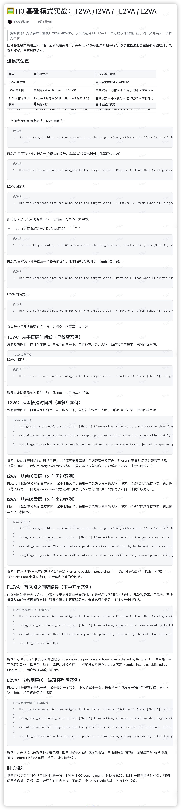

# H3 数字人资料：插件使用、提示词与原图

根据用户提供的 4 张截图整理。文字版按原图顺序保留正文、表格、代码可见内容与自检清单；原始图片保留原尺寸、内容和水印。

## 插件下载与使用

- [H3 数字人插件下载与使用指南](docs/h3/plugins-guide.md)：三个插件与额外依赖、源码和工作流下载、模型下载与目录、uv 安装、本地口播、歌曲 MV、RunningHub、扩写 API、常见问题及教程资源。
- [逐仓库源码笔记](docs/h3/plugins-source-notes.md)：固定提交与源码引用、节点输入输出、音频保留原理、版本差异和未验证项。

插件资料核对日期为 **2026-11-20**。当前 LongVideo 的 MV 与口播使用不同采样链，三个插件并非所有路线都必装。“无限时长”是分段生成再合并；本仓库保存的是研究与使用资料，没有完成实机推理验证。

## 文字阅读目录

| 顺序 | 文档 | 内容 |
| --- | --- | --- |
| 1 | [H3 提示词入门：为什么它这么吃提示词](docs/h3/01-prompt-introduction.md) | 模型输入思路、失败原因、五种输入模式、写前自检、阅读顺序 |
| 2 | [H3 提示词结构解析：三大核心字段与镜头语法](docs/h3/02-prompt-structure.md) | 三大字段、时间线、运镜、说话人与台词、画外音、画面文字、语法速查 |
| 3 | [H3 基础模式实战：T2VA / I2VA / FL2VA / L2VA](docs/h3/03-basic-modes.md) | 模式速查、参考图对齐指令、四种模式示例与拆解、时长核对 |
| 4 | [H3 全参考模式实战：Ref2VA 六段式写法](docs/h3/04-reference-mode.md) | 六段结构、参考标签、任务前缀、保留关系、声音联动、案例骨架、写后自检 |

### 整理范围与原图限制

- 文字版是对截图的转录整理，关于模型和官方规范的说法沿用原文，未另行查证。
- 截图拼接造成的重复段落合并为一份，保留重复区域中可辨识的独有内容；代码显示行号、水印和点赞等界面装饰不算正文。
- 图片中存在代码行右侧截断、表格遮挡、局部文字被拼接覆盖等情况。文字版逐处标明缺失或不可辨识的位置，不以猜测内容补齐。
- 英文示例保持原语言；尖括号标签放入代码格式，避免 GitHub 将它们当作 HTML 隐藏。
- 原文提到《MiniMax H3：模型总览》，但本次 4 张附件不含该篇，未纳入整理。
- [逐图覆盖核对与缺失清单](docs/h3/coverage.md)

## 原图预览

### H3 提示词入门：为什么它这么吃提示词

### H3 提示词结构解析：三大核心字段与镜头语法

### H3 基础模式实战：T2VA / I2VA / FL2VA / L2VA

### H3 全参考模式实战：Ref2VA 六段式写法

